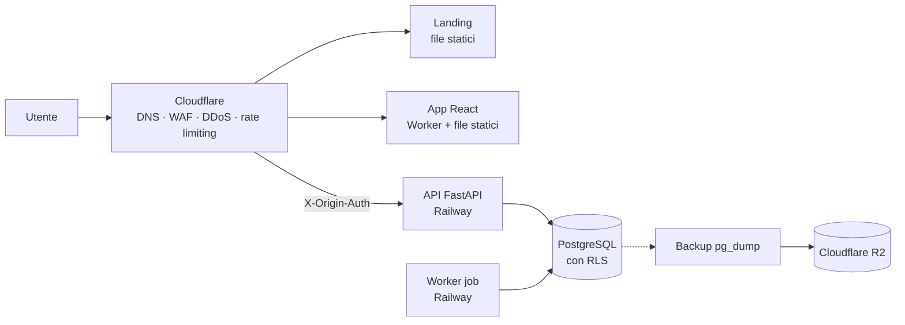

# Architettura del progetto

## Panoramica

Due parti, un solo repository:

| Parte | Cartella | Dominio | Dove gira | Tecnologia |
|---|---|---|---|---|
| App | `frontend/` | `app-curriculai.necsora.com` | Cloudflare Workers | React + Vite (SPA) |
| API | `backend/` | `api-curriculai.necsora.com` | Railway (EU West) | FastAPI + PostgreSQL 16 |

Struttura di un modulo, isolamento tra tenant (RLS) e convenzioni del codice:
`docs/backend-guidelines.md`.

## Livelli di sicurezza

| Livello | Cosa fa | Dove |
|---|---|---|
| Rete | DDoS, WAF managed rules, Bot Fight Mode | Cloudflare |
| Edge | Rate limiting su `/auth/*` | Cloudflare |
| Origine | Solo traffico passato da Cloudflare (`X-Origin-Auth`); `ORIGIN_SHARED_SECRET` è obbligatorio in staging/produzione | `app/shared/security.py` |
| Browser | HSTS, CSP rigorosa, X-Frame-Options, cookie `__Host-` HttpOnly | `_headers`, backend |
| Richiesta | Controllo Origin (CSRF), CORS, rate limiting in-app | `app/shared/security.py` |
| Applicazione | Autenticazione, ruoli, validazione Pydantic | moduli |
| Dati | Row-Level Security per tenant | Postgres |
| Configurazione | L'app non parte in cloud con segreti deboli o di test | `app/shared/config.py` |
| Processo | Lint, Bandit, pip-audit, npm audit, gitleaks | CI |

## Decisioni (ADR)

**ADR-001 · Monolite modulare invece di microservizi.**
Un solo sviluppatore con agenti: i microservizi aggiungerebbero costi operativi senza benefici
organizzativi. I confini tra moduli sono comunque netti e verificati, quindi un modulo potrà
essere estratto come servizio se mai servirà.

**ADR-003 · Multi-tenancy con database condiviso e Row-Level Security.**
La soluzione più semplice ed economica, resa sicura dalla RLS di Postgres.
Alternative scartate per ora: schema per tenant, database per tenant.

**ADR-004 · Contratto API tramite OpenAPI e client TypeScript generato.**
Le modifiche incompatibili emergono in compilazione e in CI, non in produzione.

